# MIC 求解流程图解

`milp` 一边找可行解，一边计算还有没有更好的可能，只有证到最优才报告最优。`planner` 从一份初始安排出发，在给定预算内反复调整，交回搜索期间评分最好的一份安排。两个 crate 各自运行。下面以最小化问题说明 MILP 的界，以任务分配说明规划器的评分。

## 1. MILP 怎样把原模型交给搜索器

输入包括变量类型（连续、整数、二元）、上下界、线性约束、目标方向和目标常数。入口先验证模型。对于部分整数模型，求解器能认出背包、覆盖、互斥选项等结构，利用专门算法找解或建立证明。具体分派取决于模型和配置。

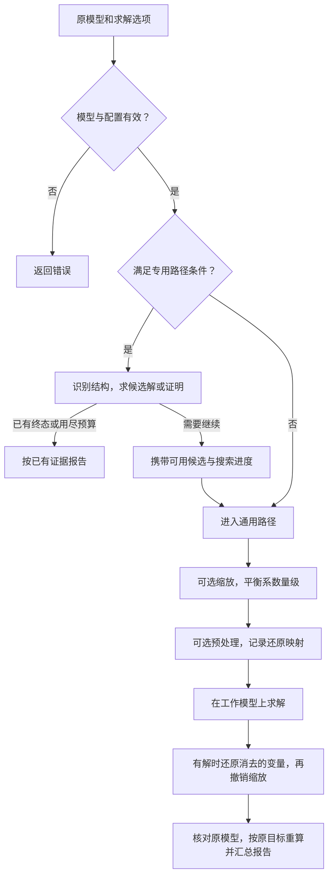

预处理可以固定变量、删除冗余行或聚合重复列，所以搜索器返回的第几个数，未必对应用户输入的第几个变量。还原映射解决的是这个问题。原目标的常数项也在最终重算时计入。候选解提供一个已经做得到的目标值，专用路径若只找到候选，仍需要界或完整搜索来证明最优。[求解入口与还原](../milp/src/solver.rs) · [预处理](../milp/src/presolve.rs) · [缩放](../milp/src/scaling.rs)

## 2. 一个节点的线性松弛怎样求解

暂时允许整数变量取小数，就得到线性规划（LP）松弛。原节点的每个整数可行解都在松弛域里，因此最小化时，松弛最优值是这个节点的下界。稠密引擎直接更新单纯形表，稀疏引擎按列存矩阵，通过基矩阵的分解计算搜索方向。两者使用相同的可行性与证明规则。

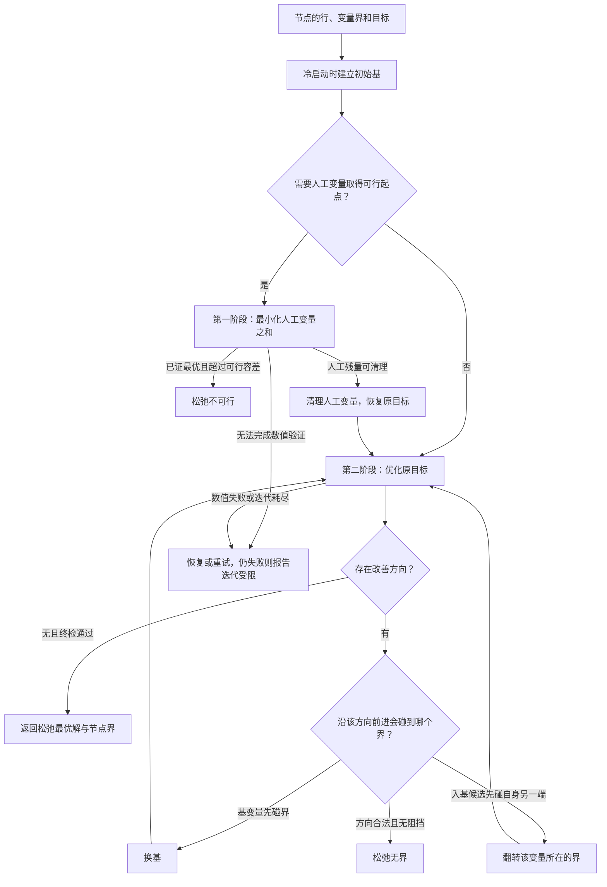

“基”是当前用来解方程的一组列。子节点通常只改少数变量的界，求解器可以沿用上一份基再修复，省去从头求解的工作。过小的主元会让换基在数值上不可靠，因此方向上确有阻挡、但算不出安全步长时，不能据此证明无界。[稠密单纯形](../milp/src/simplex.rs) · [稀疏单纯形及两套引擎的契约](../milp/src/simplex_sparse.rs)

## 3. MILP 怎样从节点界走到全局证明

根节点先解松弛。纯连续模型可直接使用 LP 结果。含整数变量时，根割可加入对所有整数解都成立、却能排除部分小数解的约束，例如 Gomory 割和混合整数舍入割。启发式则从另一侧入手，尝试尽早找到一个可行整数解，使后续节点更容易剪枝。

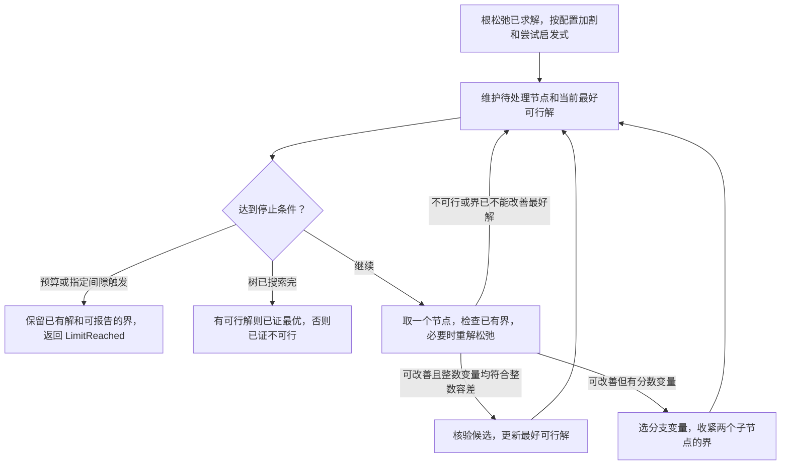

例如某个整数变量在松弛解里取 2.4，两个分支分别要求它至多为 2、至少为 3，合起来覆盖所有整数取值。若当前已有成本 100 的方案，下界为 103 的分支就可以整个跳过。单线程主要按深度优先展开；并行时先共同处理根阶段，再由各线程用私有 LP 引擎处理子树，空闲线程可以从别的队列取走节点。计算全局界时还要考虑正在处理的节点。[分支定界](../milp/src/branch_bound.rs) · [割平面](../milp/src/cuts.rs) · [并行节点管理](../milp/src/parallel_bb.rs)

读报告时先看状态，然后看有没有解向量。`Optimal` 表示已经证明最优，`Infeasible` 表示已经证明不可行，`Unbounded` 表示无界。`LimitReached` 可能带有可行解，也可能尚无解。指定相对间隙而提前停机时，查看 `gap_terminated` 和 `gap_percent`；两者记录触发停机时所依据的界与可行解之间的差距。[状态定义](../milp/src/model.rs) · [搜索控制](../milp/src/search_ctrl.rs)

## 4. Planner 怎样得到第一份安排

基础模型为每个实体给出允许的值。例如任务是实体，机器是值；任务有资源需求，各机器有容量，某些任务彼此冲突，安排到不同机器也可能产生不同成本。评分按 `(hard, soft)` 从小到大比较，先比较硬约束违反量，只有相等时才比较软成本。

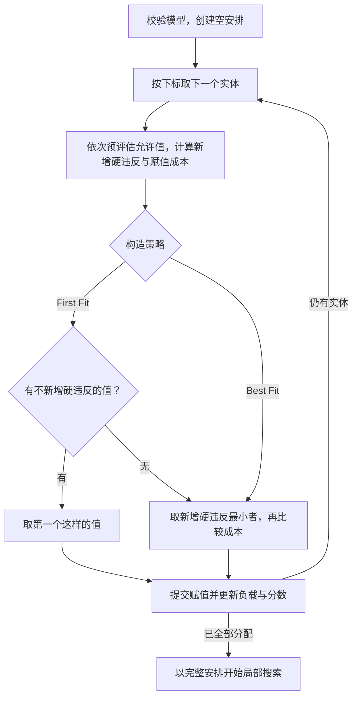

基础模型的硬分是各资源超容量的数量之和，加上同值冲突对数。软分是已分配实体的赋值成本总和。例如两项任务各占 3 单位容量，放在同一台容量为 5 的机器上，又恰好彼此冲突，就产生 1 单位超量和 1 对冲突，硬分为 2。构造时即使每个值都会新增违反，也会为实体选一个值，随后搜索仍有机会修复。[模型](../planner/src/model.rs) · [构造策略](../planner/src/construct.rs) · [评分公式](../planner/src/score.rs)

## 5. Planner 怎样试走一步并保住历史最好解

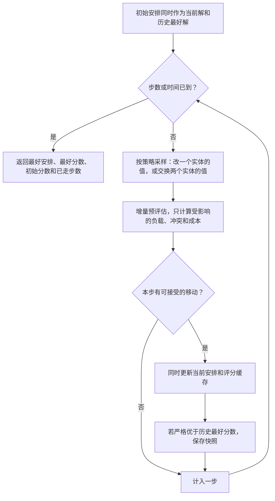

三种策略改变的是图中“可接受”的判断。

- **禁忌搜索**每步采样多个移动，从允许的候选里选分数最好的一个。刚动过的实体会暂时禁用，但若候选能刷新历史最好分数，就允许破例。候选同分时保留先采到的一个。
- **模拟退火**每步试一个移动。改善或持平时接受，变差时按温度和变差幅度决定接受概率。计算分差时给硬分足够大的权重，使硬违反的变化优先于软成本。
- **迟到接受**每步把一个候选与环形历史表中对应位置的旧分数比较。候选不差于旧分数就接受，随后用决策后的当前分数覆盖该位置。

当前解允许暂时变差，返回时取保存的最好快照。比如先把一个任务移走可能暂时增加成本，却能腾出位置消除另一处容量冲突。固定种子和步数便于复现；按墙钟时间停止时，实际完成步数会受运行环境影响。[移动生成](../planner/src/moves.rs) · [接受规则和停止条件](../planner/src/localsearch.rs)

## 6. Planner 的并行搜索与业务模型入口

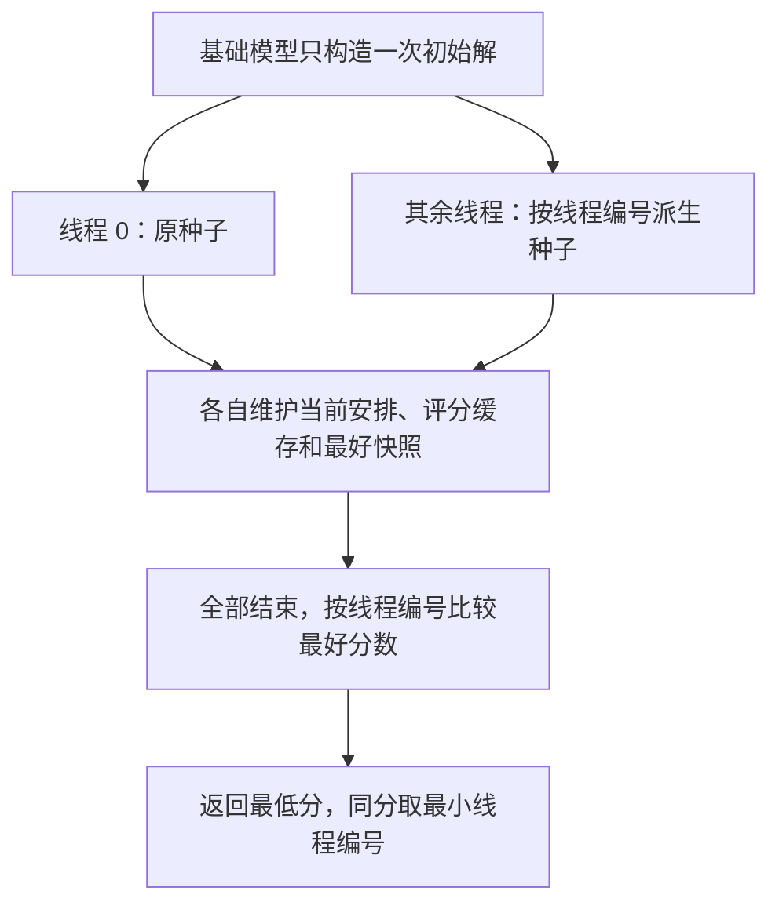

这解释了两个 crate 的并行方式为何不同。MILP 的多个线程分担同一棵证明树；基础 Planner 的多个线程从同一份初始安排出发，以不同随机序列探索邻域。固定步数时，线程 0 保留了单线程的那次搜索。[基础求解入口](../planner/src/solver.rs) · [多线程结果汇总](../planner/src/parallel.rs)

业务接口还支持同一实体有多个变量，以及既要分配归属、又要确定顺序的列表，例如把工序分给机器并确定加工顺序。这里的结果单独记录完整性和停止原因。


读取业务结果时，`complete` 表示安排是否完整，`feasible()` 要求完整且硬分为零。`NoMoves` 表示没有可做的移动，对外映射为 `Completed`；步数或时间耗尽映射为 `LimitReached`。这两个出口都没有给出全局最优证明。[业务模型](../planner/src/business/mod.rs) · [业务搜索及结果](../planner/src/business/search.rs) · [列表操作](../planner/src/business/sequence.rs)

## 7. 预处理如何缩小模型，又如何还原答案

设二元变量代表是否选中物品。若三个变量在所有剩余约束中的系数分别相同，且三者的目标系数也相同，模型只关心选了几个。预处理可以用取值为 0 到 3 的一个整数变量替代三列。假如求解器返回 2，还原时按原顺序把前两个置 1，第三个置 0。这解释了为什么合并前要同时比较约束列和目标系数。漏掉后一个条件，展开后就可能得到成本不同的方案。

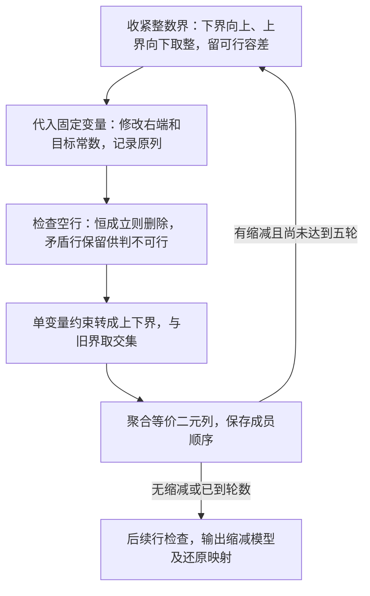

顺序影响结论。例如整数变量的区间若是 [2.3, 2.3]，先收紧整数界便会得到空区间；抢先把它固定为 2.3 会把非法取值带进后续求解。又如固定变量在目标中贡献 7，删列之后这 7 要移入目标常数。否则变量虽然能正确还原，搜索时用来比较的目标却会偏移。图中展示通用五条规则；实现还会在规则前后处理满足额外条件的容量行、比例行等结构。[预处理规则与映射](../milp/src/presolve.rs)

## 8. 根节点如何同时改进界和可行解

以最小化为例，设根松弛给出下界 80，一份已验证的整数方案成本为 100。最优成本就在 [80, 100] 内。加有效割可以把左端向右推；找到更便宜的可行方案可以把右端向左推。两条路径提供的证据不同，后面的变量固定和剪枝会一起使用它们。

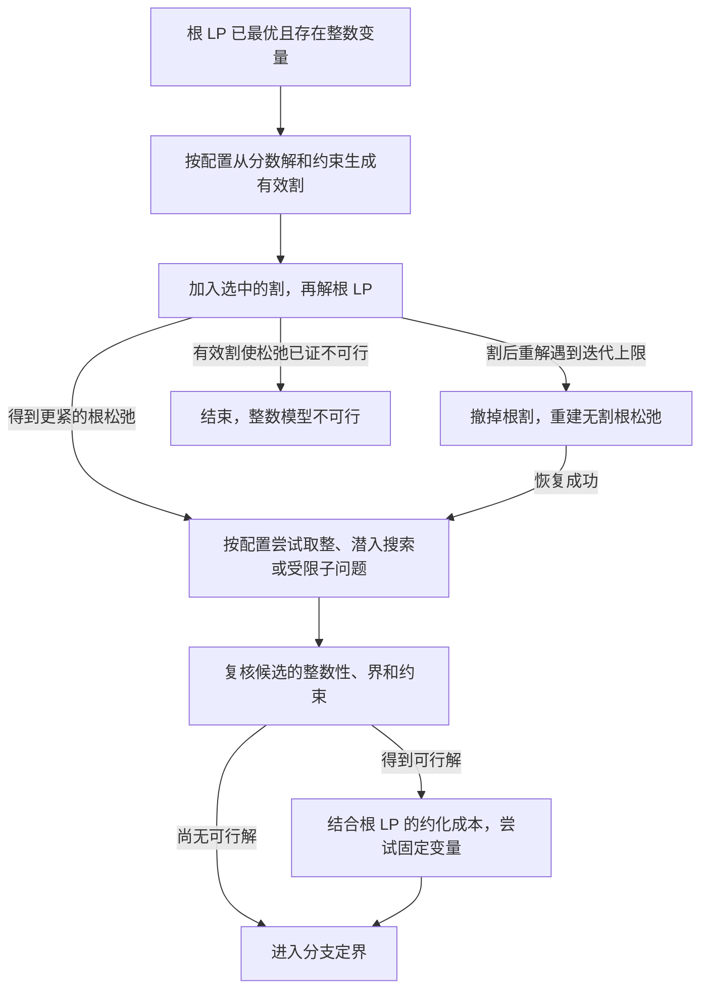

**割的例子。** 三件物品重量都是 4，容量是 10，每件最多选一次。三件同时选会超重，所以“最多选两件”是有效的覆盖割。原容量行允许松弛解 (1, 1, 0.5)，加入这条割后它就被排除，而原来的每个整数可行方案都满足新约束。实现还支持从单纯形表行生成 Gomory 割、从单行或聚合行生成混合整数舍入割。具体启用的割族和轮数由配置决定。[割的生成与根循环](../milp/src/cuts.rs)

**可行解的来源。** 直接取整便宜，但可能违反容量。潜入搜索（dive）沿部分取整决定向下试探，每次收紧界后重解松弛。受限子问题（sub-MIP）则可以暂时固定根解中已经取整数值的变量，在较小的树里寻找候选。这样的固定有助找解；要永久排除某个取值，还需要证明。例如根 LP 的约化成本能够证明某个贴界整数变量离开该界后，目标已不可能优于现有方案，才可据此固定它。[启发式](../milp/src/heuristics.rs) · [根节点调度](../milp/src/branch_bound.rs)

## 9. 手算一次 MILP 搜索，再看实现怎样回溯

考虑最小化成本 4x + 7y，要求 2x + 3y ≥ 3，x、y 均为二元变量。下面按原始 LP 松弛做教学推演，略去预处理、割和结构专用路径，实际运行的节点数可能更少。

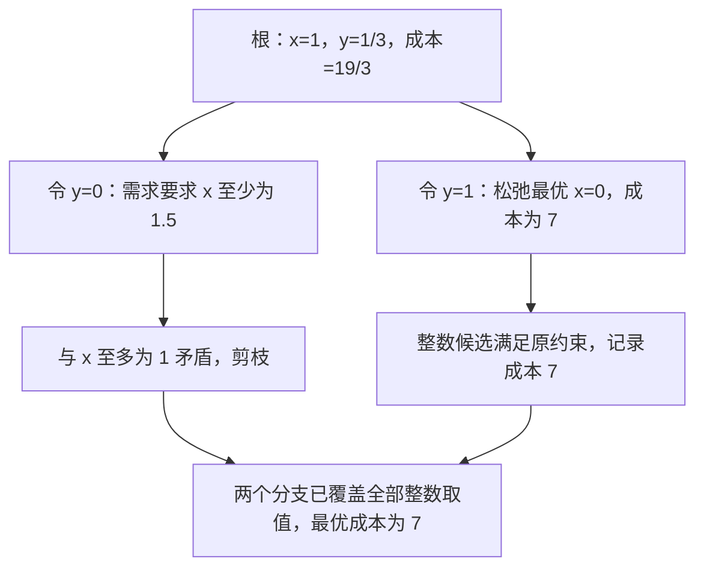

在根节点，x 每单位需求的成本为 2，比 y 的 7/3 低，所以松弛先用满 x，再用三分之一个 y 补足需求。19/3 低于 7 完全合理，因为根解用了现实中不能选择的分数件。若刚找到成本 7 的解时仍有一个下界为 6 的未处理分支，证明仍未完成。

单线程默认用两个栈处理这件事。待办栈存“下一步给哪个变量加哪一侧的界”；修改记录栈保存“改之前的界”。从左分支回到右分支时，先按相反顺序恢复到共同父节点，再施加右分支的界。否则左边留下的 y ≤ 0 会和右边的 y ≥ 1 同时生效，导致漏解。选哪个变量分支也有不同规则：最分数规则关注离整数最远的变量，伪成本规则利用已观察到的分支代价估计收紧各候选变量的效果。[分支规则、栈与回溯](../milp/src/branch_bound.rs)

还有两种容易误读的出口。第一，某节点的 LP 用尽迭代额度时，该子树仍有未知部分；顺序搜索可以继续其他子树，但要保留未完成标记和旧界。第二，在整数容差内的数值解取整后仍须复核。若原约束被破坏，求解器还要继续分支。相应地，报告中的节点数和 LP 迭代数也不能混用；一个节点可以经历许多次换基，根阶段恢复状态的求解还可能只增加迭代数。[节点判定与统计口径](../milp/src/branch_bound.rs)

## 10. 手算 Planner 的一次移动

有任务甲、乙，各需 3 单位容量，彼此冲突。机器 A 容量为 5，机器 B 为 4，两项任务都允许放到任一机器。甲留在 A 的成本为 2，乙在 A 和 B 的成本分别为 1 和 4。假设当前两项任务都在 A。下面跟踪把乙从 A 移到 B 的全过程。

| 评分项 | 移动前 | 移动后 | 变化原因 |
| --- | ---: | ---: | --- |
| A 的超载量 | 1 | 0 | 负载从 6 降到 3 |
| B 的超载量 | 0 | 0 | 负载从 0 升到 3，仍在容量内 |
| 同机冲突对数 | 1 | 0 | 甲、乙现在分属两台机器 |
| 硬分 | 2 | 0 | 同时消除超载和一对冲突 |
| 软分 | 3 | 6 | 乙的成本增加 3 |

候选分数 (0, 6) 优于当前的 (2, 3)，因为先比硬分。若搜索策略接受这一步，乙的赋值、两台机器的负载和总分须同步更新。若拒绝，下一次试探仍从 (2, 3) 开始。

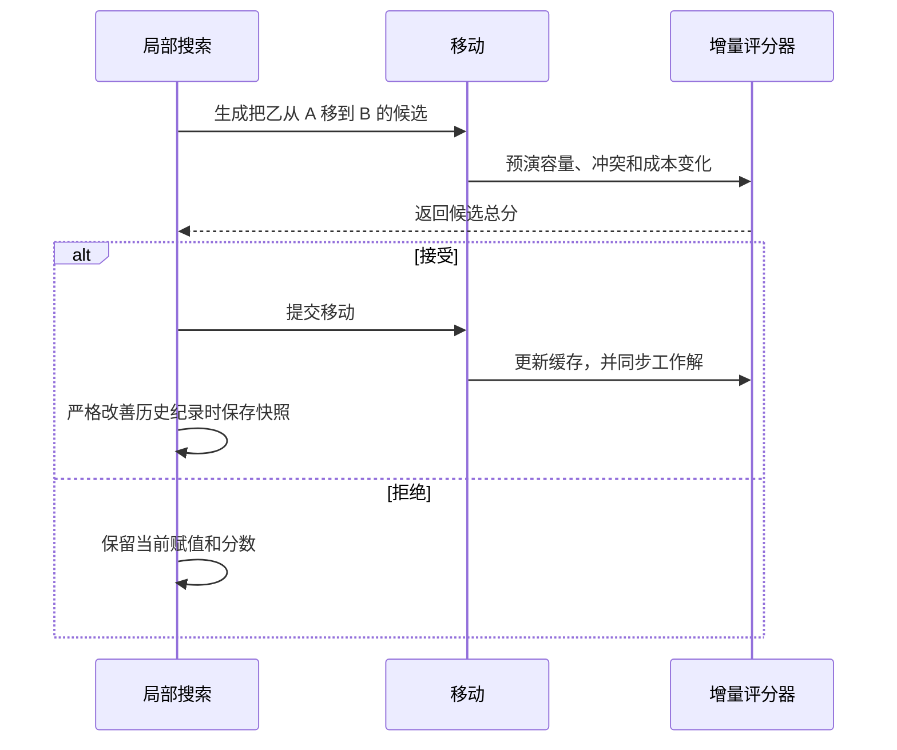

单实体改值只需看它涉及的资源、旧值和新值，以及与该实体相连的冲突边。交换两个实体时，两边都必须允许对方的原值。若两实体之间本身有冲突边，交换前后它们的值仍然互异，这条边不能算成新增或消除的冲突。实现让预演和提交共用分差计算逻辑，另有从赋值独立重算的全量评分器可供核对。[增量评分实现](../planner/src/score.rs) · [移动的预演与提交](../planner/src/moves.rs)

## 11. 搜索为何有时会接受更差的安排

假设当前分数为 (0, 10)，某个合法移动给出 (0, 12)。三个算法面对同一候选，答案可能完全不同。

| 策略 | 本步比较什么 | 对这个候选的可能决定 |
| --- | --- | --- |
| 禁忌搜索 | 一批样本中允许移动的分数，另查实体禁忌期限 | 即使成本上升，只要它是允许样本中最好的，仍可选中；若实体被禁且未刷新历史纪录，就跳过 |
| 模拟退火 | 候选相对当前解的标量分差和当前温度 | 硬分相同，分差为 2；温度为 2 时以 exp(−1) ≈ 36.8% 的概率接受 |
| 迟到接受 | 历史表本轮对应槽位的分数 | 槽位是 (0, 13) 就接受，是 (0, 11) 就拒绝；随后写入决策后的当前分数 |

基础规划器退火时用“硬分 × 权重 + 软分”算分差，权重取所有成本项之和加 1；硬分改善一个单位足以压过软成本的变化。温度每步乘 0.999，最低取配置的结束温度。历史最好解仍按硬分、软分依次比较。禁忌搜索则在并列候选中保留先采到的一项，这使采样顺序也成为复现结果的一部分。[三种决策的实现](../planner/src/localsearch.rs)

基础模型的“步数”指决策机会。生成器先试首选移动种类，最多八次，均失败再试另一类；两类都失败时可以走一个空步。例如所有任务都只能选同一个值，改值或互换都无法产生新安排，固定步数搜索仍会照常计步。业务接口则另有 `NoMoves` 停止原因。分析日志时应先确认调用的是哪一个入口。[移动生成与回退](../planner/src/moves.rs) · [业务停止原因](../planner/src/business/search.rs)

## 12. 业务规划器如何处理表达式、路线和工序

基础评分器内置容量、冲突和赋值成本；业务模型允许模型作者声明表达式和具名罚项。例如可以表达“某道工序最晚何时完工”，再把超过交期的部分作为罚项。每个表达式只能引用此前声明的节点，因此可以按声明顺序求值。运行时也知道哪些表达式依赖某个变化的输入。

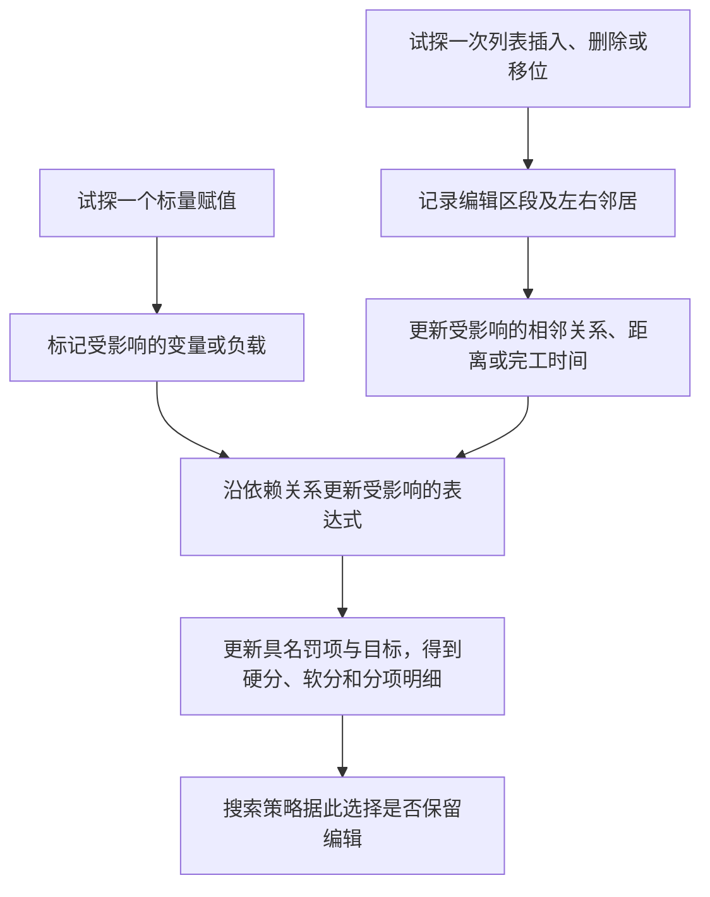

**配送路线。** 原路线有连续两站 A、C，在中间插入 B 后，原路段 A→C 消失，新路段 A→B 和 B→C 出现。距离变化等于两段新距离之和减去原距离。编辑记录保留左右邻居，使评分器可以定位这几段；涉及路线端点时则按实际存在的邻居处理。[列表编辑与路段差分](../planner/src/business/sequence.rs)

**工序排程。** 若工序乙必须等甲完成，同时乙所在机器还要先做丙，乙要等两项前置工作都结束后才能开工。沿机器顺序移动乙，可能改变后续多道工序的完工时间，因此更新范围可以越过直接邻居。工艺前置关系与机器顺序若合起来形成环，就无法给出满足这些先后关系的排程。[顺序传播与成环检查](../planner/src/business/sequence.rs)

**部分安排。** 构造期间，未赋值的标量可能使表达式值未知。算术和比较会传递未知，聚合只统计已知项，尚未确定的罚项和目标暂计零。因此，读业务输出时要把完整性、硬分以及逐规则罚分一起看；仅看到构造中途的硬分为零，还不足以认定已排出可行方案。[业务评分语义](../planner/src/business/score.rs)

## 13. 用仓库算例对照流程

在仓库根目录可分别运行以下命令。第一条适合把 MILP 的目标值和终态对起来看，第二条固定种子、步数和策略，适合反复比较规划器的初始与最好分数。

```bash
cargo run --manifest-path milp/Cargo.toml --release -- milp/instances/knapsack-10.milp
cargo run --manifest-path planner/Cargo.toml --release -- planner/instances/roster-small.txt --steps 2000 --seed 7 --algo tabu --construct bf
```

看 MILP 时，先问“有没有可行解”，再问“还剩哪些可能更好的分支”；看 Planner 时，先问“安排是否完整且硬分为零”，再比较软成本。例如一个模型提前停机并交回方案，MILP 的界能说明还剩多少改进空间，而 Planner 的历史最好分数说明本次搜索确实到过什么水平。[MILP 命令行入口](../milp/src/main.rs) · [Planner 命令行入口](../planner/src/main.rs)
